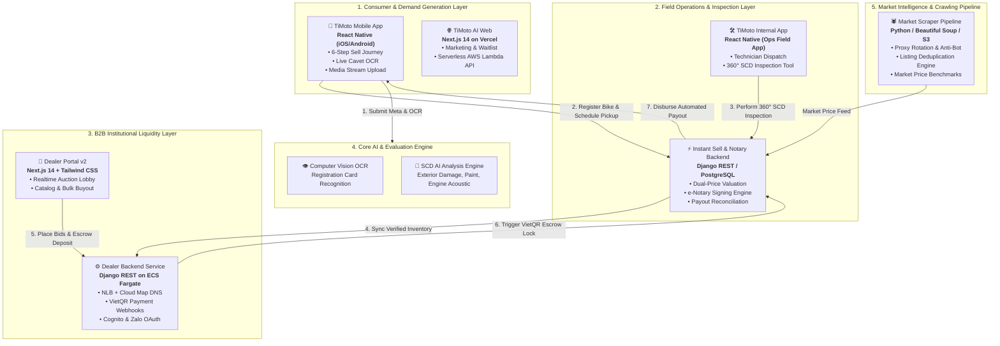
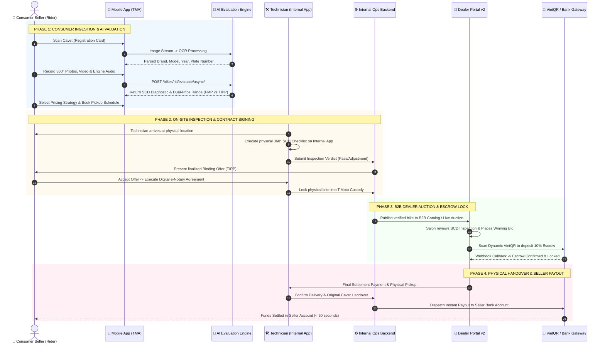
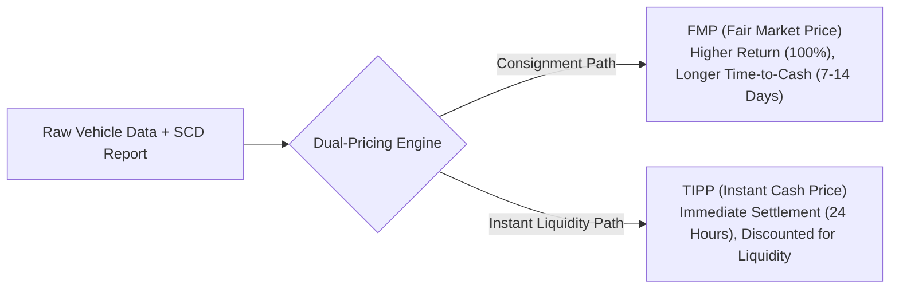
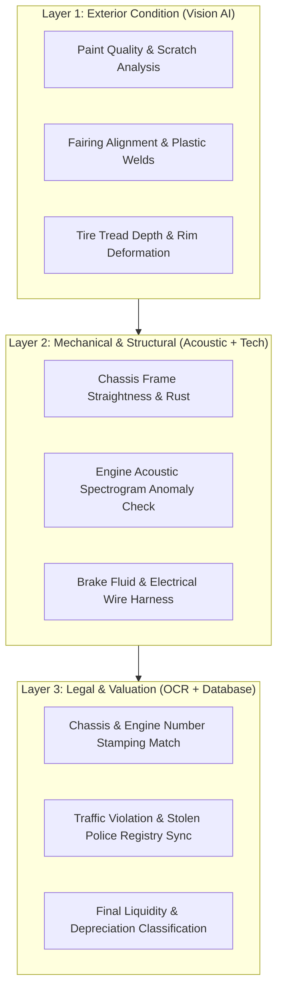
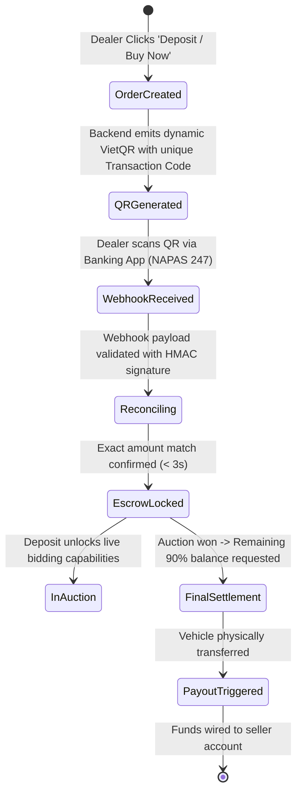

# TiMoto AI Platform: Comprehensive Architecture & End-to-End System Specifications

> **Target Audience:** Engineering, Product Architecture, Operations & Leadership teams  
> **Reading Time:** ~7–10 minutes  
> **Scope:** Complete 6-Repository Ecosystem Architecture, Data Topologies, Lifecycle State Machines, and Core Protocols

---

## 1. Executive Summary & Platform Mission

**TiMoto AI** is an AI-first automotive liquidity and marketplace infrastructure platform designed to modernize the fragmented two-wheeler (motorbike) market in Southeast Asia. 

The platform bridges consumer supply with institutional B2B demand by combining:
1. **Automated Computer Vision & Audio AI Inspection:** Real-time motorbike registration card (Cavet) OCR, 360° exterior damage detection, engine acoustic anomaly detection, and Standard Condition Document (SCD) report generation.
2. **Algorithmic Dual-Pricing Engine:** Instant pricing resolution balancing **Fair Market Price (FMP)** for peer-to-peer consignment and **TiMoto Instant Purchase Price (TIPP)** for immediate liquidity.
3. **End-to-End Field Operations & Digital Notary:** Dispatch orchestration for field technicians, digital on-site contract execution (e-Notary), and automated bank account validation.
4. **B2B Dealer Marketplace & Escrow Liquidity:** Real-time auctioning, catalog buy-now checkout, dynamic **VietQR Escrow deposit locking**, and automated seller payout reconciliation.

---

## 2. Global System Architecture (The 5-Pillar Ecosystem)

The architecture is divided into five specialized sub-systems that interact via authenticated REST APIs, secure WebSockets, and asynchronous event-driven synchronizations.



---

## 3. End-to-End Vehicle Lifecycle (4-Phase Execution Model)



---

## 4. Repository & Codebase Matrix

The platform is maintained across 6 specialized Git repositories:

| Repository Name | Primary Tech Stack | Infrastructure / Deployment | Core Responsibilities |
| :--- | :--- | :--- | :--- |
| **`timoto-mobile`** | React Native, TypeScript, Redux Toolkit, Django REST | AWS ECS Fargate, Aurora PostgreSQL, S3 Media Bucket | • Consumer sell flow (6 stages).<br/>• Realtime OCR scanning.<br/>• Audio/Video upload pipelines.<br/>• Zalo & Apple Social Authentication.<br/>• Customer pickup scheduling. |
| **`timoto-internal-app`** | React Native (Field App), Django REST, PostgreSQL | AWS ECS Fargate, S3, FCM Notifications | • Technician on-site dispatch.<br/>• 360° SCD inspection workflows.<br/>• Instant Sell & Dual-Pricing calculation engine.<br/>• Electronic Notary contract generation.<br/>• Bank account verification & Payout engine. |
| **`timoto_dealer_portal_v2`** | Next.js 14 (App Router), Tailwind CSS, TypeScript | AWS ECS Fargate Frontend (Nginx), Route53, NLB | • Modern dealer frontend.<br/>• Live bidding rooms & catalog listings.<br/>• Dynamic VietQR modal generator.<br/>• Dealer KYC & financial history dashboard. |
| **`timoto-dealer-portal`** | Django 5 REST Framework, Celery, Redis | AWS ECS Fargate (x86_64), Cloud Map DNS (`srv-mltilck3366moqxh`) | • Dealer order lifecycle state machine.<br/>• VietQR payment webhook parser & reconciler.<br/>• AWS Cognito OTP & Zalo OAuth backend.<br/>• OneSignal push notification broadcaster. |
| **`TiMoto-AI-Web`** | Next.js 14, Tailwind CSS, AWS Lambda | Vercel Global Edge Network, AWS Lambda (Waitlist) | • Public brand presence and marketing landing.<br/>• Serverless consumer waitlist intake engine. |
| **`chototcaodulieu`** | Python 3.12, BeautifulSoup4, Requests, S3 | AWS EC2 / Cron Worker, Rotating Proxy Network | • Large-scale market data scraping (Chợ Tốt).<br/>• Data deduplication algorithms.<br/>• Historical price modeling & depreciation curve generator. |

---

## 5. Architectural Deep Dives & Protocols

### 5.1 Algorithmic Dual-Pricing Protocol (FMP vs. TIPP)

When a vehicle is ingested, the system calculates two distinct financial paths:

$$\text{FMP} = \text{Base Market Price} \times (1 - \text{Depreciation}_{\text{Age}}) - \text{SCD Damage Penalty}$$

$$\text{TIPP} = \text{FMP} \times (1 - \text{Holding Cost Margin} - \text{Liquidity Discount}) - \text{Immediate Reconditioning Cost}$$



- **FMP (Fair Market Price):** Targeted for peer-to-peer buyers looking for market parity. The vehicle is listed on the public catalog while remaining in seller custody until matched.
- **TIPP (TiMoto Instant Purchase Price):** Guaranteed cash offer where TiMoto purchases the bike directly onto its balance sheet for B2B wholesale distribution.

---

### 5.2 SCD (Standard Condition Document) 3-Layer Inspection

The inspection engine enforces a strict 3-tier validation hierarchy before any vehicle can be listed or purchased:



---

### 5.3 VietQR Dynamic Escrow & Webhook Reconcile Engine

To eliminate payment friction and counterparty default risk in B2B auctions, TiMoto implements an automated VietQR Escrow state machine:



---

## 6. Infrastructure & Deployment Topology

```
                         [ Internet Traffic ]
                                  │
                   ┌──────────────┴──────────────┐
                   ▼                             ▼
       [ dealer.timoto.ai ]             [ api.timoto.ai ]
                   │                             │
                   ▼                             ▼
         Route53 (Hosted Zone)         AWS API Gateway / ALB
                   │                             │
                   ▼                             ▼
        Network Load Balancer (NLB)     Mobile Backend (Django)
                   │                             │
                   ▼                             ▼
         Nginx Frontend (ECS)           AWS Aurora PostgreSQL
                   │                             │
    Cloud Map DNS (dealer.local:8000)            │
                   │                             │
                   ▼                             ▼
        Dealer Backend (ECS Fargate) <─── S2S Internal Auth
                   │
                   ▼
         PostgreSQL (RDS Multi-AZ)
```

### Key Production Infrastructure Specifications:
- **AWS Region:** `ap-southeast-7` (Primary Production).
- **Compute Cluster:** AWS ECS Fargate (`timoto-dealer-fargate`, `timoto-mobile-prod`).
- **Internal Service Discovery:** AWS Cloud Map (`backend.timoto-dealer-portal.local:8000`).
- **Zero-Downtime Deployment Protocol:** Rolling task definition replacement with automatic stale target group deregistration and DNS resolver refresh (`resolver 169.254.169.253 valid=10s`).
- **Data Persistence:** AWS Aurora PostgreSQL Serverless Multi-AZ clusters with automated point-in-time recovery.

---

## 7. Engineering Best Practices & Guidelines

1. **API Contracts as Single Source of Truth:** All cross-team modifications must update `docs/CONTRACT.md` before implementation.
2. **Idempotent Webhook Processing:** All financial transactions (VietQR, Payouts) must implement strict deduplication tokens and HMAC verification.
3. **Fail-Safe S2S Fallbacks:** Remote internal API calls (such as user bank verification) must handle transient network drops gracefully without breaking the primary user experience.
4. **Clean Room Data Synchronization:** Scraper data pipelines run in isolated execution sandboxes with proxy rotation to protect production data integrity.
