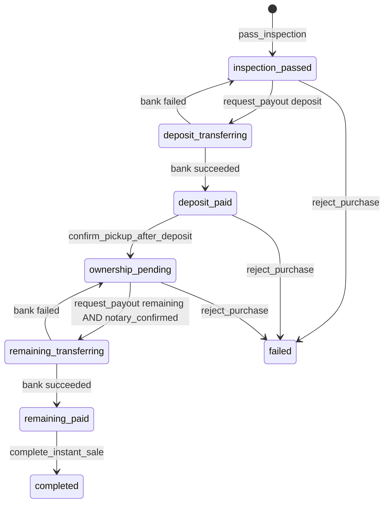

# 1. Overview & Business Intent

Instant Sell lets OPS buy a bike from a TMA seller after inspection. Payout is two legs: deposit = `purchase_price_vnd // 2`, remaining = `purchase_price_vnd - deposit`. Happy path **never writes status `picked_up`**. That status is the old listing/pickup path (`sale.ensure_sale_record_picked_up`).

**Actors:** OPS RN (`PickupSend.tsx`, `PurchaseProgress.tsx`), bank stub or HTTP payout API, HMAC webhook, TMA `push_sale_status`.

**Target files:**

- `timoto-internal-app/backend/bikes/instant_sell.py`
- `timoto-internal-app/backend/bikes/purchases_api.py`
- `timoto-internal-app/backend/bikes/payouts.py`
- `timoto-internal-app/backend/bikes/sale.py` (`SaleTransitionError`, `mark_sale_complete`)
- Routes: `backend/bikes/api_urls.py` under `/api/`
- Frontend: `apps/src/api/purchases.ts`, `apps/src/pages/Purchase.tsx`, `WaitingPickupDetail.tsx`, `PickupSend.tsx`, `PurchaseProgress.tsx`, `RejectPickupBike.tsx`

Constants:

```
USER_DB_WRITE = 'user_db_write'
WAITING_PICKUP_STATUSES = ('scheduled', 'confirmed')
DEPOSIT_CONFIRM_KEYS = ('bike_matches_listing', 'deposit_paid_confirmed')
NOTARY_CONFIRM_KEYS = ('seller_signed', 'notary_confirmed_transfer')
COMPLETE_CONFIRM_KEYS = ('documents_received', 'remaining_paid_confirmed')
```

`has_bank_info(record)`: `bank_account_number` strip nonempty **and** (`bank_name` or `bank_bin`) strip nonempty.

---

# 2. End-to-End Flow & Sequence Diagram

```mermaid
sequenceDiagram
  autonumber
  actor Ops as PickupSend / PurchaseProgress
  participant API as purchases_api.py
  participant Eng as instant_sell.py
  participant DB as bike_sale_records / payouts
  participant Bank as payouts.initiate_payout
  participant TMA as push_sale_status

  Ops->>API: POST /api/purchases/{bike_id}/inspection/pass/
  API->>Eng: pass_inspection
  Eng->>DB: INSERT/UPDATE status=inspection_passed
  Eng->>TMA: _push_tma
  API-->>Ops: 200 full _purchase_detail_payload

  Ops->>API: POST /api/purchases/{bike_id}/deposit/pay/
  API->>Eng: request_payout kind=deposit
  Eng->>DB: status=deposit_transferring
  Eng->>Bank: initiate_payout idempotency_key=sale_id:deposit
  alt stub succeeded
    Eng->>DB: deposit_paid payout.succeeded
  else http pending
    Eng->>DB: stays deposit_transferring
    Bank-->>API: later POST /api/webhooks/bank/payout/
  else failed
    Eng->>DB: rollback inspection_passed
    API-->>Ops: 200 plus escalate_to Henry
  end

  Ops->>API: POST confirm-pickup {bike_matches_listing:true, deposit_paid_confirmed:true}
  Eng->>DB: ownership_pending
  Ops->>API: POST notary/confirm {seller_signed, notary_confirmed_transfer}
  Note over Eng: status UNCHANGED ownership_pending; checklist.notary_confirmed=true
  Ops->>API: POST remaining/pay
  Eng->>DB: remaining_paid or remaining_transferring
  Ops->>API: POST complete {documents_received, remaining_paid_confirmed}
  Eng->>DB: completed
```



Webhook `apply_payout_webhook` lookup by `provider_ref`, **no lock**. Allowed normalized values: `succeeded`, `failed`, `pending`. Invalid message: `'status must be succeeded or failed.'` (does not mention `pending`).

---

# 3. Detailed API Contracts

Auth on purchase views: `IsAuthenticated` then `_require_ops` (`OpsUser`). Envelope on `SaleTransitionError`: `('ok': false, 'error': ('code'  '<exc.code>', 'message'  '<exc.message>'))`. HTTP = `exc.status_code`.

| Method | Path | View |
| --- | --- | --- |
| GET | `/api/purchases/` | `PurchasesListView` |
| GET | `/api/purchases/<uuid:bike_id>/` | `PurchasesDetailView` |
| PATCH | `/api/purchases/<uuid:bike_id>/bank/` | `PurchaseBankView` |
| POST | `/api/purchases/<uuid:bike_id>/inspection/pass/` | `PurchaseInspectionPassView` |
| POST | `/api/purchases/<uuid:bike_id>/deposit/pay/` | `PurchaseDepositPayView` |
| POST | `/api/purchases/<uuid:bike_id>/confirm-pickup/` | `PurchaseConfirmPickupView` |
| POST | `/api/purchases/<uuid:bike_id>/notary/confirm/` | `PurchaseNotaryConfirmView` |
| POST | `/api/purchases/<uuid:bike_id>/remaining/pay/` | `PurchaseRemainingPayView` |
| POST | `/api/purchases/<uuid:bike_id>/complete/` | `PurchaseCompleteView` |
| POST | `/api/purchases/<uuid:bike_id>/reject/` | `PurchaseRejectView` |
| POST | `/api/webhooks/bank/payout/` | `BankPayoutWebhookView` |

List query: `view` = `day`|`week`|`month` (invalid → `day`); `date` ISO (invalid → `local_today()`); `scope` = `queue`|`history` (invalid → `queue`); `q` searches brand/model/`masked_bike_id`/`license_plate`/`user__full_name`/`user__phone_number`; `sale_channel` kept only if in `instant_sell`|`listing`. Universe: `PricingEntry.status == 'SUBMITTED'`. Queue = waiting pickups ∪ in-progress sales. History = completed/failed ∪ pickup completed/rejected.

Inspection pass body: `actual_odometer`, `inspection_notes`, `inspection_checklist` (must be object), `sale_channel` default `instant_sell`. RN sends `(odo_ok, interior_ok, exterior_ok, documents_ok)` and **no** `sale_channel`.

Webhook: `AllowAny`, `authentication_classes = []`, `csrf_exempt`. Header `HTTP_X_TIMOTO_SIGNATURE` = `sha256=` + hex HMAC-SHA256 of **raw body**. Secret: `BANK_PAYOUT_WEBHOOK_SECRET` or `TMA_WEBHOOK_SECRET` or `WEBHOOK_HMAC_SECRET`. Body `(provider_ref, status, error_message?)`.

`sale_actions` gates (exact):

- `can_pay_deposit` / `deposit_cta_enabled`: status `== inspection_passed` **and** `has_bank_info`
- `bank_info_missing`: `inspection_passed` and not bank
- `can_confirm_pickup`: `deposit_paid`
- `can_confirm_notary`: `ownership_pending` and not `checklist.notary_confirmed`
- `can_pay_remaining`: `ownership_pending` and `notary_confirmed` and bank
- `can_complete_sale`: `remaining_paid`
- `can_reject`: status in `IN_PROGRESS_STATUSES`
- `escalate_to_henry`: deposit or remaining payout `== failed`

| HTTP Code | Error Code | Trigger |
| --- | --- | --- |
| 422 | `CONFIRMATIONS_REQUIRED` | flags not JSON `true` (`is True`) |
| 404 | `SALE_NOT_STARTED` | pass inspection first / sale not found |
| 409 | `SALE_TERMINAL` | already closed |
| 422 | `BANK_INFO_MISSING` | payout without bank |
| 409 | `NOTARY_NOT_CONFIRMED` | remaining payout before notary |
| 409 | `SALE_WRONG_STATE` | cannot pay kind from current status |
| 409 | `DEPOSIT_NOT_PAID` | confirm pickup too early |
| 409 | `REMAINING_NOT_PAID` | complete too early |
| 422 | `INVALID_REASON` | reject reason shorter than 5 chars |
| 404 | `PICKUP_NOT_WAITING` | no waiting pickup and sale not already inspection_passed |
| 401 | `Invalid signature` | webhook HMAC mismatch |
| 503 | `Webhook not configured` | empty webhook secret |

Price resolution: listing → `listing_price_vnd` then `offer_to_user`; instant → `instant_price_vnd` then `offer_to_user`; fallback `schedule.valuation_price`. `split_purchase_amounts` raises `ValueError('purchase price must be positive')` if `total_vnd <= 0` — **not** wrapped as `SaleTransitionError`.

---

# 4. Database Schema & State Transitions

**No `SELECT FOR UPDATE`** in `instant_sell.py`, `purchases_api.py`, `payouts.py`, or `sale.py`. Idempotency for payouts is `UniqueConstraint(fields=['sale', 'kind'], name='uniq_bike_sale_payout_kind')` plus key `f'(record.id)::kind'`.

```sql
CREATE TABLE bike_sale_records (
    id UUID PRIMARY KEY,
    bike_id UUID NOT NULL UNIQUE,
    status VARCHAR(32) NOT NULL DEFAULT 'picked_up',
    sale_channel VARCHAR(16) NOT NULL DEFAULT 'instant_sell',
    purchase_price_vnd BIGINT NULL,
    deposit_amount_vnd BIGINT NULL,
    remaining_amount_vnd BIGINT NULL,
    bank_account_name VARCHAR(255) NULL,
    bank_account_number VARCHAR(64) NULL,
    bank_name VARCHAR(128) NULL,
    bank_bin VARCHAR(16) NULL,
    bank_source VARCHAR(16) NULL,
    checklist JSONB NOT NULL DEFAULT '{}'::jsonb,
    CONSTRAINT bike_sale_records_status_check CHECK (status IN (
        'inspection_passed','deposit_transferring','deposit_paid',
        'ownership_pending','remaining_transferring','remaining_paid',
        'picked_up','completed','failed'
    ))
);

CREATE TABLE bike_sale_payouts (
    id UUID PRIMARY KEY,
    sale_id UUID NOT NULL REFERENCES bike_sale_records(id) ON DELETE CASCADE,
    kind VARCHAR(16) NOT NULL CHECK (kind IN ('deposit','remaining')),
    amount_vnd BIGINT NOT NULL,
    status VARCHAR(16) NOT NULL DEFAULT 'pending' CHECK (status IN ('pending','succeeded','failed')),
    provider VARCHAR(32) NOT NULL DEFAULT 'stub',
    provider_ref VARCHAR(128) NULL,
    CONSTRAINT uniq_bike_sale_payout_kind UNIQUE (sale_id, kind)
);
```

Payout retry: existing `succeeded` snaps transferring → paid, no second bank call. Existing `pending` returns immediately. Existing `failed` reuses row, same idempotency key, calls `initiate_payout` again.

`BANK_PAYOUT_MODE`: `stub` (immediate succeeded, `provider_ref=stub-:kind-:uuid4`), `async_stub` (pending until webhook), `http` (POST `BANK_PAYOUT_API_URL`, timeout 30s, header `Idempotency-Key`). Unknown mode → stub. Failed HTTP user message: `'Bank transfer failed. Escalate to Henry.'`

TMA push: `(sale_status, sale_channel, purchase_price_vnd, deposit_amount_vnd, remaining_amount_vnd)`.

---

# 5. Frontend & UI Logic

`API_PATHS.PURCHASES = '/purchases/'`. `patchPurchaseBank` is **never called from any page**.

| Page | Calls | Body |
| --- | --- | --- |
| `Purchase.tsx` | `getPurchases` | `view`, `date`, `scope`, `q` — **no** `sale_channel` |
| `WaitingPickupDetail.tsx` | `getPurchaseDetail` | if sale in ownership/remaining/completed → `PurchaseProgress`; else inspect → `PickupSend` |
| `PickupSend.tsx` | pass + deposit pay + poll + confirm pickup | checklist four bools; confirm `(bike_matches_listing  true, deposit_paid_confirmed  true)`; modal ids `match`/`deposit` |
| `PurchaseProgress.tsx` | notary + remaining + complete | `(seller_signed, notary_confirmed_transfer)`; complete `(documents_received, remaining_paid_confirmed)`; modal ids `seller`/`notary`, `docs`/`paid` |
| `RejectPickupBike.tsx` | `postPurchaseReject` then `postPickupReject` on 404 | `:reason` min 5 |

Poll: `pollPurchaseDetail` default `attempts=8`, `intervalMs=800`; stops if `ready(detail)` or `actions.escalate_to_henry`. Failed payout 200 extra field `escalate_to` string `'Henry'`; UI reads `actions.escalate_to_henry`.

`SALE_STATUS_UI` labels: `Đã kiểm tra` (blue), `Đang chuyển tiền cọc` (orange), `Đã thanh toán cọc` (teal), `Chờ công chứng` (purple), `Đang chuyển số tiền còn lại` (orange), `Chờ hoàn tất giao dịch` (teal), `Đã thu xe` (teal), `Giao dịch hoàn tất` (green), `Giao dịch thất bại` (gray).

---

# 6. Edge Cases & Resilience

1. **No row lock.** Concurrent deposit pay can race; uniqueness is `(sale_id, kind)` only. Webhook lookup by `provider_ref` has no lock.
2. **Notary does not change status.** Remaining payout requires `checklist.notary_confirmed`, which is set internally in addition to the two request flags.
3. **Second complete on `completed` raises `REMAINING_NOT_PAID`** because the gate is `!= remaining_paid`, not a dedicated already-complete short-circuit in `complete_instant_sale`.
4. **Confirm pickup with no waiting schedule** still sets `ownership_pending` without writing pickup `completed` → later `PICKUP_NOT_COMPLETED` (404) from `mark_sale_complete`.
5. **Inspection idempotent:** no waiting schedule but sale already `inspection_passed` returns 200 full detail. Existing in-progress non-`inspection_passed` returns unchanged.
6. `confirm_notary` / complete are **not** short-circuit idempotent.
7. Access JWT is not involved in webhook; empty secret → 503. Header must be `sha256=<hex>`.
8. Locmem vs Redis does not apply here; bank mode stub succeeds synchronously so RN poll may see `can_confirm_pickup` immediately.
