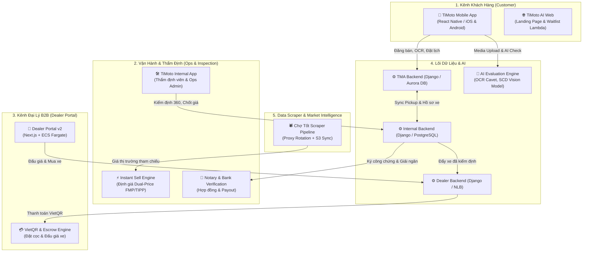
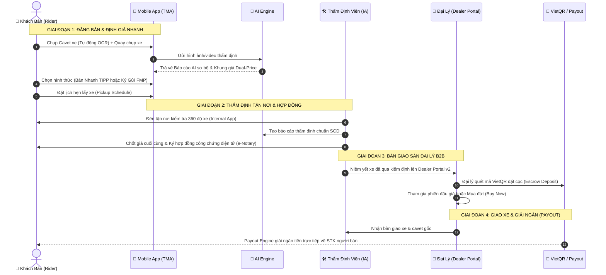

<Info>
**Mục tiêu tài liệu:** Giúp toàn bộ thành viên Tech, Product và Ops nắm bắt bức tranh toàn cảnh (End-to-End Architecture) của hệ thống **TiMoto AI** chỉ trong **5 phút đọc**.
</Info>

---

# 1. Bức Tranh Tổng Thể Hệ Sinh Thái (System Architecture)

Hệ sinh thái TiMoto AI bao gồm **5 khối thành phần chính** phối hợp chặt chẽ qua REST API, WebSocket và Event-driven Sync:

---

# 2. Vòng Đời Xe 4 Giai Đoạn (End-to-End Lifecycle)

Toàn bộ hành trình từ lúc chủ xe đăng bán đến khi đại lý nhận xe và người bán nhận tiền:

<Columns cols={2}>
  <Card title="Giai Đoạn 1 & 2: Thu Mua (Supply)" icon="motorcycle">
    Khách hàng cá nhân bán xe qua App Mobile. Công nghệ AI OCR Cavet và SCD Vision hỗ trợ định giá tức thì (Instant Sell) và điều phối kỹ thuật viên đến tận nơi.
  </Card>
  <Card title="Giai Đoạn 3 & 4: Phân Phối (Demand)" icon="building-columns">
    Xe đã kiểm định được đẩy lên sàn B2B cho hàng trăm salon/đại lý đấu giá. Hệ thống VietQR Escrow đảm bảo an toàn thanh toán 100%.
  </Card>
</Columns>

---

# 3. Bản Đồ Trách Nhiệm & Repositories (Tech Stack Matrix)

<Tabs>
  <Tab title="1. Mobile & Web Frontend">
    - **`timoto-mobile`**: 
      - *Stack:* React Native, TypeScript, Redux Toolkit, React Navigation.
      - *Chức năng:* Luồng đăng bán 6 bước, OCR Cavet tự động, Upload đa phương tiện (Ảnh/Audio/Video), chọn giá Dual-Price (TIPP/FMP), đặt lịch Pickup, tích hợp Zalo SDK & Apple Sign-In.
    - **`TiMoto-AI-Web`**:
      - *Stack:* Next.js 14, Tailwind CSS, Vercel, AWS Lambda (Waitlist).
      - *Chức năng:* Trang giới thiệu sản phẩm và tiếp nhận đăng ký sớm.
  </Tab>

  <Tab title="2. Internal Operations (IA)">
    - **`timoto-internal-app`**:
      - *Stack:* Django 5 REST Framework, PostgreSQL Aurora, React Native (Ops App).
      - *Chức năng:* 
        - Quản lý lịch Pickup của kỹ thuật viên.
        - Quy trình kiểm định xe 360 độ (SCD Report).
        - **Instant Sell Engine:** Quyết định giá thu mua và ký hợp đồng công chứng điện tử.
        - **Deposit & Payout Engine:** Xác thực tài khoản ngân hàng và kích hoạt lệnh giải ngân.
  </Tab>

  <Tab title="3. Dealer Portal B2B">
    - **`timoto_dealer_portal_v2` & `timoto-dealer-portal`**:
      - *Stack:* Next.js (V2 Frontend) + Django REST (Backend on AWS ECS Fargate + NLB).
      - *Chức năng:*
        - Sàn đấu giá và catalog mua buôn xe máy cho đại lý.
        - Tích hợp cổng thanh toán tự động VietQR (Dynamic QR & Webhook Reconcile).
        - Quản lý tài khoản đại lý (Cognito OTP & Zalo OAuth).
  </Tab>

  <Tab title="4. Scraper & AI Core">
    - **`chototcaodulieu`**:
      - *Stack:* Python, BeautifulSoup, AWS S3, Proxy Pool.
      - *Chức năng:* Thu thập và chuẩn hóa dữ liệu tin đăng xe máy toàn thị trường (Chợ Tốt), khử trùng lặp (Deduplication) để xây dựng biểu đồ giá thị trường chuẩn xác.
  </Tab>
</Tabs>

---

# 4. Các Khái Niệm Cốt Lõi Cần Nhớ (Cheat-Sheet)

<AccordionGroup>
  <Accordion title="Dual-Price (FMP vs TIPP) là gì?">
    - **FMP (Fair Market Price):** Giá ký gửi bán lẻ trên sàn P2P (giá cao hơn, chờ tìm người mua).
    - **TIPP (TiMoto Instant Purchase Price):** Giá TiMoto thu mua đứt ngay lập tức (nhận tiền trong 24h).
  </Accordion>
  <Accordion title="Báo cáo kiểm định SCD (Standard Condition Document)">
    Hệ thống phân tích 3 lớp: **Ngoại thất (Exterior) $\rightarrow$ Động cơ & Khung gầm (Engine/Frame) $\rightarrow$ Định giá & Hồ sơ pháp lý**.
  </Accordion>
  <Accordion title="Cơ chế bảo chứng VietQR Escrow">
    Đại lý đặt cọc qua VietQR tự động khớp lệnh trong 3 giây. Tiền cọc được giữ an toàn tại tài khoản bảo chứng cho đến khi giao nhận xe thành công.
  </Accordion>
</AccordionGroup>

<Check>
**Đã đồng bộ:** Toàn bộ chi tiết kỹ thuật chuyên sâu của từng module có thể tra cứu chi tiết trong các thư mục `docs-kb/` tương ứng.
</Check>
